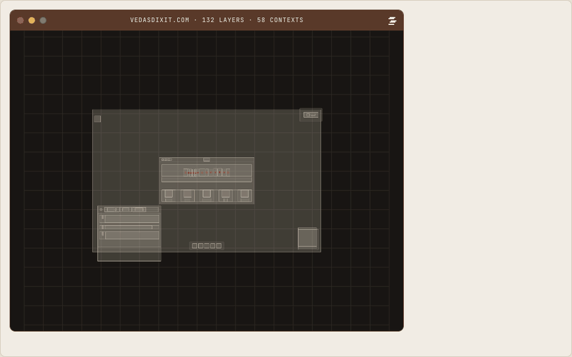
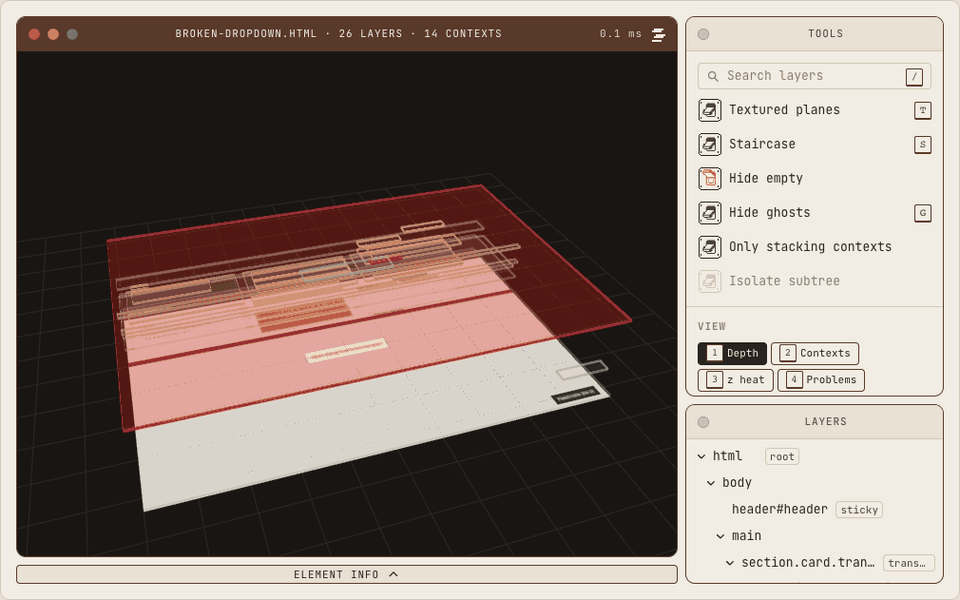
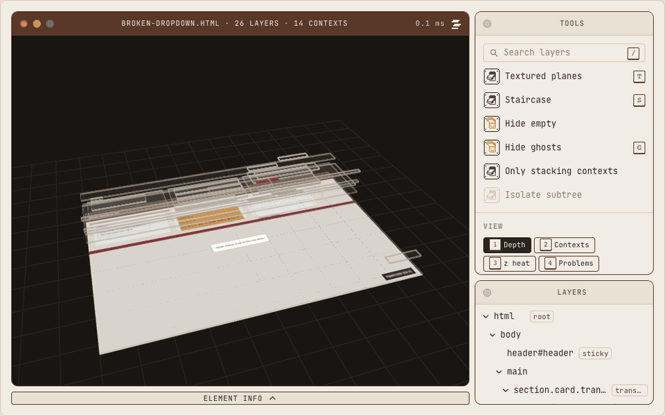
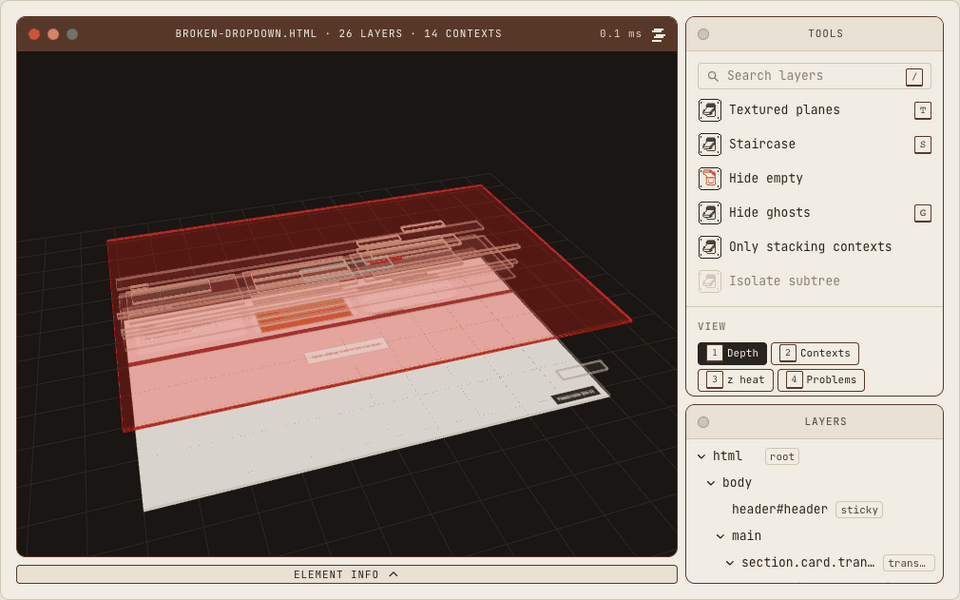

# Stackray

Lift any web page into a 3D stack of its layers, right on top of the tab you are looking at.



Stackray is a browser extension for a question every frontend developer has asked at some point: why is my dropdown behind the header? Click the icon and the page shrinks into a small retro‑Mac window, then splits into planes, one per element, stacked in the order the browser actually paints them. Hover a plane to see what it is. Click it to see why it sits where it does. Press Esc and the page is back, untouched.

It is early. It works in Chrome if you build it yourself, and it is not in any store yet.

## What it shows

### Why is my dropdown behind that?



This page has a dropdown with `z-index: 9999` that still paints under a header with `z-index: 10`. Press `4` for Problems mode and it turns red: its card has a `transform`, which starts a new stacking context, so the dropdown can never leave the card no matter how big its z‑index gets. Hover it for the short version, click it for the whole chain of contexts with the CSS reason for each one.

The big red sheet at the start is an invisible full‑screen overlay, the kind that quietly eats your clicks. Invisible elements are drawn red in every mode. `G` hides them.

### Color modes, textures, a staircase and search

<table>
  <tr>
    <td width="50%" valign="top">
      
      <p><code>1</code> to <code>5</code>: depth, one hue per stacking context, z‑index heat, problems, plain. Red only ever means a problem, and every mode has a legend.</p>
    </td>
    <td width="50%" valign="top">
      
      <p><code>T</code> gives each leaf plane its own pixels from a photo of the page, so the exploded page still looks like the page. Containers stay outlines so nothing is drawn twice.</p>
    </td>
  </tr>
  <tr>
    <td width="50%" valign="top">
      
      <p><code>S</code> puts every layer on its own step in paint order, so you can read the whole order from bottom to top. The explode slider goes from a flat page to an architectural model.</p>
    </td>
    <td width="50%" valign="top">
      
      <p><code>/</code> searches the layers, initials and partial matches included, and Enter picks the top match. <code>L</code> opens the ladder: everything that competes directly under the root, sorted by z. That is the answer to "what is on top of everything?".</p>
    </td>
  </tr>
</table>

A few more things it does without being asked:

- Elements cut off by an `overflow: hidden` ancestor get a red dashed edge. Elements that are only scrolled out of view get a plain dashed edge, because you could still scroll to them.
- Modal dialogs, open popovers and fullscreen elements are hoisted to the top, where the browser puts them.
- The 3D order is the browser's paint order, not DOM nesting. A `z-index: 9999` inside a transformed card really does sit below a `z-index: 10` header, and Stackray draws it that way.
- Everything has a key, and `?` lists them.

## Try it

You need Node 22 or newer and pnpm 10.

```sh
git clone https://github.com/vedas-dixit/Stackray.git
cd Stackray
pnpm install
pnpm --filter @stackray/extension build
```

Open `chrome://extensions`, turn on Developer mode, click "Load unpacked" and pick `apps/extension/.output/chrome-mv3`. On any page, click the Stackray icon or press Alt+Shift+S. Press it again, or Esc, to put the page back. After a rebuild, press the reload arrow on the Stackray card.

To play with the tool without the extension, run `pnpm dev`. It opens the viewer, where you can drop in a snapshot JSON or open `/?fixture=broken-dropdown`. Every GIF on this page was recorded there.

WXT can also build for Firefox (`pnpm --filter @stackray/extension build:firefox`), but that build has not been tried.

## Keys

| Key          | Does                                                  |
| ------------ | ----------------------------------------------------- |
| Esc          | Close and restore the page                            |
| `]` / `_`    | Collapse the tools / info window                      |
| `Z`          | Collapse both                                         |
| `1`…`5`      | Color modes: depth, contexts, z heat, problems, plain |
| `G`          | Hide or show ghosts                                   |
| `T`          | Textured planes                                       |
| `S`          | Staircase: one step per layer in paint order          |
| `L`          | Show the ladder                                       |
| `/`          | Search the layers                                     |
| `?`          | Show this list                                        |
| Arrows       | Orbit                                                 |
| Space + drag | Pan                                                   |

With the mouse: drag to orbit, hold Space and drag to pan (middle or right drag also pans), scroll to zoom toward the cursor, hover for the tooltip, click to select, and double‑click to go back to the page with that element outlined.

## Privacy

Stackray has two permissions, `activeTab` and `scripting`. Nothing runs on a page until you click the icon or press the shortcut, and then only in that tab. It makes no network requests and has no account, analytics or telemetry. The snapshot and the screenshots stay in memory in that tab and are dropped when you close the stage.

A few things are worth knowing:

- **It scrolls the page.** Before the stage opens, Stackray photographs the page one screen at a time (up to 6 screens) and then scrolls back. The page reacts as it would to you scrolling: lazy images load, and any scroll tracking on the page sees it.
- **It leaves two small traces in the page.** A `<style>` tag with `@font-face` rules stays until you reload, and pane sizes are saved in the page's own `localStorage` under `stackray:layout:<origin>`. The page's scripts can see both. The sizes should move to extension storage; that needs the `storage` permission, which is still an open decision.
- **Pages can tell it is installed.** The fonts are web-accessible resources, so a page that knows the extension's ID can check for them.
- **Snapshots are not anonymous.** A snapshot JSON holds the page URL and title, element ids and classes, `aria-label`s, and up to 30 characters of an element's own text where that is the best label. Look through one before you post it in an issue.

## Not done yet

- The "Why behind?" two‑pick mode. The one‑sentence verdict is written and tested in core, but the UI does not use it yet.
- Hit‑test mode ("why can't I click this?"). `hitTest` exists in core.
- Live mode, where planes follow changes on the page.
- Textured mode only reaches the first 6 screens of a long page; deeper planes stay plain.
- Isolate subtree filters the tree but not the 3D view.
- The share card export, the tour and compare mode.
- The yellow and green window dots are drawn but do nothing.
- Firefox and Edge builds have not been tried.
- A real icon. The current one is a placeholder pixel stack from `scripts/make-icons.ts`.

## How it is built

```
live page ──capture──▶ snapshot (plain JSON) ──▶ renderer (WebGL) ──▶ apps
                                             └─▶ ui (windows, tree, inspector)
```

`packages/core` reads the DOM once and writes a snapshot: every element with its rectangle, a few computed styles, whether it creates a stacking context and why, and its place in the paint order. It is the only package that reads the DOM. `packages/renderer` draws the snapshot with Three.js, using one instanced mesh, so ten thousand planes are a single draw call. `packages/ui` is the Preact interface, which lives in a closed Shadow DOM so the page's CSS and Stackray's never mix. The apps only decide where that UI is mounted.

```sh
pnpm dev          # the viewer at http://localhost:5173
pnpm dev:ext      # the extension in a fresh Chrome, reloading on change
pnpm test         # unit tests; core runs against a fake DOM, no browser needed
pnpm check        # Biome and tsc
pnpm preview:ui   # Playwright: component screenshots and the live frame-time test
```

- [docs/architecture.md](docs/architecture.md) walks through the code file by file.
- [SPEC.md](SPEC.md) is the plan: what Stackray should become, the element record, the budgets and the decisions so far. It wins over everything else.
- [STYLEGUIDE.md](STYLEGUIDE.md) and [docs/motion.md](docs/motion.md) cover the look and the animation.
- [CONTRIBUTING.md](CONTRIBUTING.md) covers fixtures, bug reports and pull requests.
- [CLAUDE.md](CLAUDE.md) holds the code rules. Stackray is built with help from Claude Code, which reads this file first; the rules apply to human contributors too.

## Author

<picture>
  <source media="(prefers-color-scheme: dark)" srcset="docs/author-dark.svg">
  
</picture>

<p align="center">
  <a href="https://vedasdixit.com">vedasdixit.com</a>&ensp;·&ensp;<a href="https://blog.vedasdixit.com">blog</a>&ensp;·&ensp;<a href="https://www.linkedin.com/in/vedasdixit">linkedin</a>&ensp;·&ensp;<a href="mailto:vedasdixit.work@gmail.com">email</a>
</p>

[MIT](LICENSE). The bundled fonts, Instrument Serif and JetBrains Mono, are under the SIL Open Font License.
