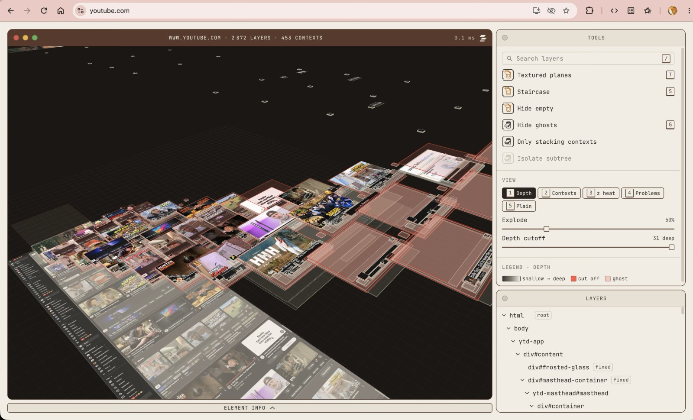
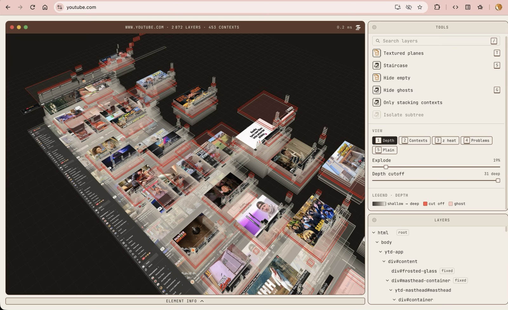

<p align="center">
  
</p>

<h1 align="center">Stackray</h1>

<p align="center">
  Lift any web page into a 3D stack of its layers, right on top of the tab you are looking at.
</p>

<p align="center">
  <a href="#install">Install</a>&ensp;·&ensp;<a href="#have-a-look">Have a look</a>&ensp;·&ensp;<a href="#keyboard-shortcuts">Shortcuts</a>&ensp;·&ensp;<a href="#whats-working-and-whats-not">Status</a>&ensp;·&ensp;<a href="CONTRIBUTING.md">Contributing</a>
</p>

<p align="center">
  
  <a href="https://chromewebstore.google.com/detail/stackray/pjfbeffpjkepgiehmigffncbenbiknah"></a>
</p>


I miss Firefox Tilt. It let you look at a web page as a 3D version of its DOM, and it was just a fun thing to play with. Stackray started from that idea.

I wanted to see if I could make something similar that was also a little useful when CSS starts behaving in confusing ways. You can tilt a page, look through its layers, and get a better feel for what is sitting on top of what. Maybe it helps you track down a stubborn `z-index`. Maybe you just want to see what a page looks like pulled apart.

It's an experiment, and there's still plenty I'd like to improve. If it looks interesting to you, give it a try or come help me build it.

## Have a look

### On a real page

<table>
  <tr>
    <td width="50%" valign="top">
      
      <p>youtube.com in Chrome: 2 872 layers and 453 stacking contexts, lifted to 50% in depth mode with textured planes.</p>
    </td>
    <td width="50%" valign="top">
      
      <p>The same page from higher up at 19%, where the feed still reads as a grid and the fixed header and sidebar sit on their own levels.</p>
    </td>
  </tr>
</table>

### Why is this behind that?


A dropdown can have `z-index: 9999` and still end up behind a header. In this example, its card has a `transform`, which creates a stacking context. The dropdown can't escape that context just by getting a bigger number.

Press `4` to switch to Problems mode. Stackray marks the issue in red; hover a layer for a quick explanation, or click it to inspect it.

Invisible elements are shown in red too. They're sometimes the reason a click never reaches the thing you meant to click. Press `G` to hide them.

### A few ways to look at a page

<table>
  <tr>
    <td width="50%" valign="top">
      
      <p><code>1</code> to <code>5</code> switch between depth, stacking contexts, z-index heat, problems and plain view. Each mode has a legend.</p>
    </td>
    <td width="50%" valign="top">
      
      <p><code>T</code> gives leaf layers their own pixels from a screenshot of the page. Containers stay as outlines, so the same content isn't drawn over and over.</p>
    </td>
  </tr>
  <tr>
    <td width="50%" valign="top">
      
      <p>Layers start on the staircase, each on its own step in paint order; <code>S</code> switches back to overlap levels. The explode slider takes the view from a flat page to a little architectural model.</p>
    </td>
    <td width="50%" valign="top">
      
      <p><code>/</code> searches the layer tree. <code>L</code> opens the z-index ladder, showing the elements that compete directly under the root stacking context.</p>
    </td>
  </tr>
</table>

A few other details:

- The 3D order follows the browser's computed paint order, rather than simply stacking elements by DOM depth.
- Elements cut off by an `overflow: hidden` ancestor get a red dashed edge. Elements that are only scrolled out of view get a normal dashed edge.
- Modal dialogs, open popovers and fullscreen elements are shown in the browser's top layer.
- You can orbit, pan, zoom, search, and select layers. Press `?` to see the keyboard shortcuts.

## Install

Stackray is on the [Chrome Web Store](https://chromewebstore.google.com/detail/stackray/pjfbeffpjkepgiehmigffncbenbiknah). Add it, open any page, and click the Stackray icon or press `Alt+Shift+S`. Press the shortcut again or hit `Esc` to close it and get the page back.

Firefox and Edge builds aren't published yet.

## Build it yourself

If you want to hack on it, or just prefer to run your own build, you'll need Node.js 22 or newer and pnpm 10.

```sh
git clone https://github.com/vedas-dixit/Stackray.git
cd Stackray
pnpm install
pnpm --filter @stackray/extension build
```

Then:

1. Open `chrome://extensions`.
2. Turn on **Developer mode**.
3. Click **Load unpacked** and select `apps/extension/.output/chrome-mv3`.
4. Open a page and click the Stackray icon, or press `Alt+Shift+S`.

After rebuilding, use the reload button on the Stackray card in Chrome's extensions page.

For Firefox, build the Firefox version instead:

```sh
pnpm --filter @stackray/extension build:firefox
```

Then open `about:debugging#/runtime/this-firefox`, click **Load Temporary Add-on** and pick `apps/extension/.output/firefox-mv3/manifest.json`. The add-on stays until Firefox restarts, and the **Reload** button on that page picks up a rebuild. `pnpm --filter @stackray/extension dev:firefox` does the same with a reload on every change.

You can also run the viewer without loading the extension:

```sh
pnpm dev
```

Open `/?fixture=broken-dropdown` to see the example page, or load a snapshot JSON of your own. The GIFs above were recorded from the viewer.

## Keyboard shortcuts

| Key            | Action                              |
| -------------- | ----------------------------------- |
| `Esc`          | Close Stackray and restore the page |
| `]` / `_`      | Collapse the tools / info window    |
| `Z`            | Collapse both windows               |
| `1`–`5`        | Switch color modes                  |
| `G`            | Show or hide invisible layers       |
| `T`            | Toggle textured planes              |
| `S`            | Toggle the staircase view           |
| `L`            | Open the z-index ladder             |
| `/`            | Search the layers                   |
| `?`            | Show the shortcut list              |
| Arrow keys     | Orbit the view                      |
| `Space` + drag | Pan the view                        |

With a mouse, drag to orbit and scroll to zoom toward the cursor. Hold Space while dragging to pan; middle- or right-drag works too. Hover a layer for its tooltip, click to select it, or double-click to return to the page with that element outlined.

## What's working, and what's not

This is a work in progress. The current build has the 3D viewer, layer tree, search, color modes, staircase view, z-index ladder, and basic inspection tools.

There are still gaps:

- The full "Why behind?" flow, where you pick two elements and get a verdict, isn't wired into the UI yet.
- Hit-test mode ("why can't I click this?") has core logic, but isn't available in the interface yet.
- Live mode, where layers follow changes on the page, isn't implemented yet.
- Textured mode only covers the first six screens of a long page. Layers further down stay plain.
- Isolate-subtree currently filters the tree, but not the 3D view.
- Share-card export, tour and compare mode are still on the list.
- The yellow and green window buttons are visual for now and don't do anything.
- The Firefox build is new and has had far less use than the Chrome one. The Edge build hasn't been tested.

If something doesn't work on a particular site, that's useful to know too. An issue with the page URL, browser version and steps to reproduce is a good place to start. Please avoid posting a snapshot publicly without checking it first; snapshots can contain page details.

## Privacy

Stackray only runs when you open it on a tab. It currently asks for two permissions: `activeTab` and `scripting`.

It makes no network requests and has no account, analytics or telemetry. The snapshot and screenshots stay in memory in that tab and are dropped when you close the stage.

There are a few caveats worth knowing:

- **It scrolls the page while taking screenshots.** Stackray captures the page one screen at a time, up to six screens, then scrolls back. As with normal scrolling, this can trigger lazy-loaded images or page scroll handlers.
- **It leaves a couple of things in the page.** A `<style>` tag with font-face rules remains until the page reloads. Pane sizes are saved in the page's own `localStorage`, under a `stackray:layout:` key. The page's scripts can see both.
- **A page may be able to detect the extension.** Its fonts are exposed as web-accessible resources, so a page that knows the extension ID can check for them.
- **Snapshots can contain page information.** A snapshot JSON includes the URL and title, element IDs and classes, `aria-label` values, and sometimes up to 30 characters of an element's text. Check a snapshot before attaching it to an issue or sharing it.

## A little about the code

The basic idea is to capture the page once, then render that snapshot separately:

```text
live page ──capture──▶ snapshot (plain JSON) ──▶ renderer (WebGL) ──▶ apps
                                                   └──▶ UI (windows, tree, inspector)
```

- `packages/core` reads the DOM and creates the snapshot. It records element bounds, relevant styles, stacking-context information and paint order.
- `packages/renderer` draws the snapshot with Three.js. It uses an instanced mesh, so thousands of planes don't need thousands of separate draw calls.
- `packages/ui` contains the Preact interface, including the windows, layer tree and inspector. It lives in a closed Shadow DOM to keep the page's styles separate from Stackray's.
- The apps decide where the viewer and UI are mounted.

Useful commands:

```sh
pnpm dev          # Run the viewer at http://localhost:5173
pnpm dev:ext      # Run the extension in a fresh Chrome
pnpm test         # Run unit tests
pnpm check        # Run Biome and TypeScript checks
pnpm preview:ui   # Run UI screenshots and the frame-time test
```

A few more notes if you want to dig in:

- [docs/architecture.md](docs/architecture.md) walks through the code.
- [SPEC.md](SPEC.md) describes the planned direction and technical contracts.
- [STYLEGUIDE.md](STYLEGUIDE.md) and [docs/motion.md](docs/motion.md) cover the visual style and animation.
- [CONTRIBUTING.md](CONTRIBUTING.md) has notes on fixtures, issues and pull requests.
- [CLAUDE.md](CLAUDE.md) contains the codebase's working rules. I use Claude Code while building Stackray, and those rules apply to contributions too.

## Want to help?

I'd love for people to try it, break it, and tell me what they find.

You don't need to take on a big feature. A weird page that renders badly, a bug report, a test case, a clearer explanation, or a small fix is all useful. If you're interested in browser rendering, CSS stacking contexts, WebGL, or just making the tool nicer to use, have a look around and open an issue or pull request.

I'm still figuring out what Stackray should become. Suggestions are welcome.

## Author

<picture>
  <source media="(prefers-color-scheme: dark)" srcset="docs/author-dark.svg">
  
</picture>

<p align="center">
  <a href="https://vedasdixit.com">vedasdixit.com</a>&ensp;·&ensp;<a href="https://blog.vedasdixit.com">blog</a>&ensp;·&ensp;<a href="https://www.linkedin.com/in/vedasdixit">linkedin</a>&ensp;·&ensp;<a href="mailto:vedasdixit.work@gmail.com">email</a>
</p>

MIT licensed. See [LICENSE](LICENSE). The bundled Instrument Serif and JetBrains Mono fonts are under the SIL Open Font License.
